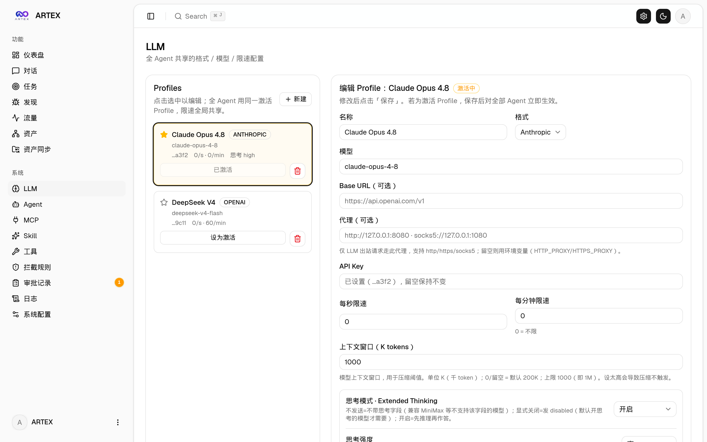
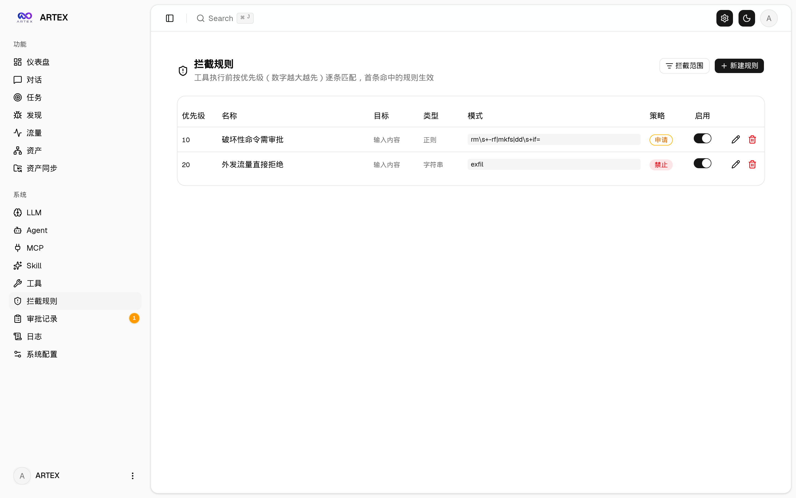
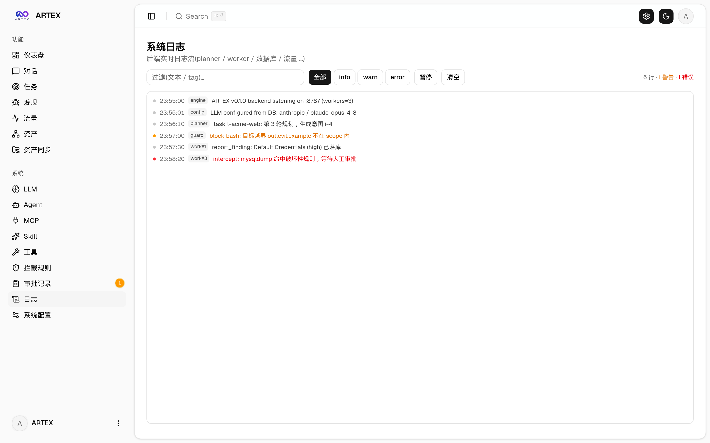
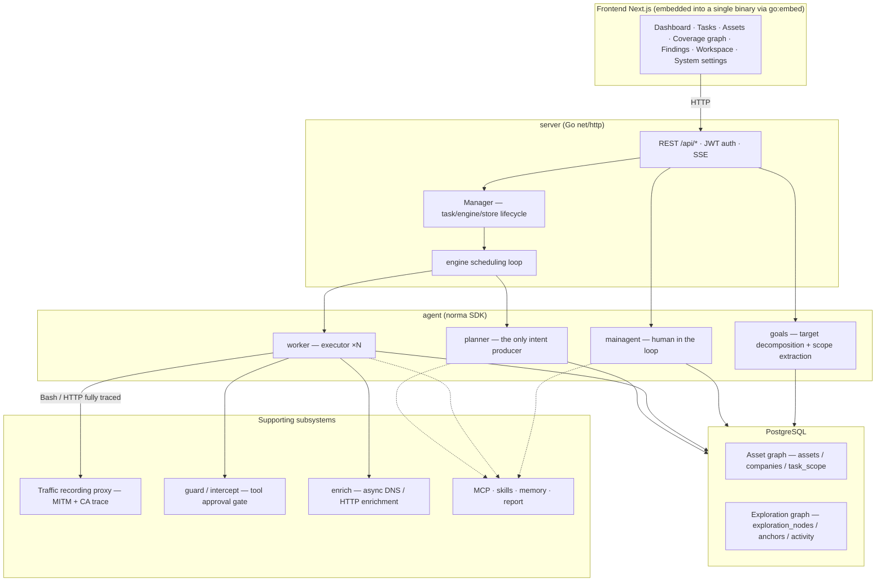
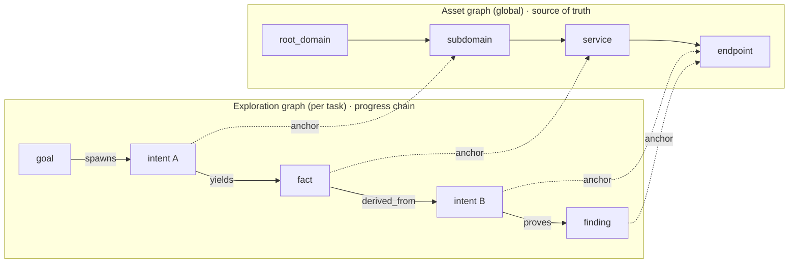
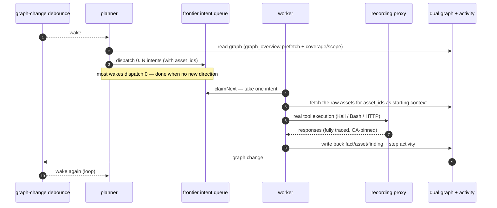
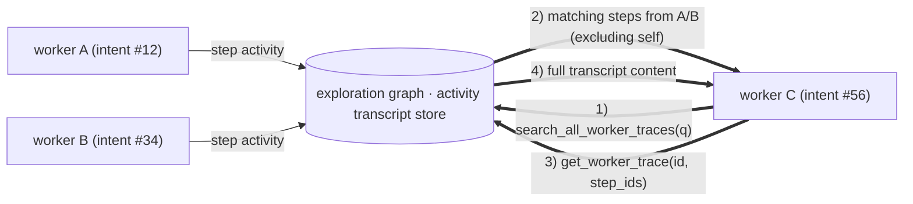
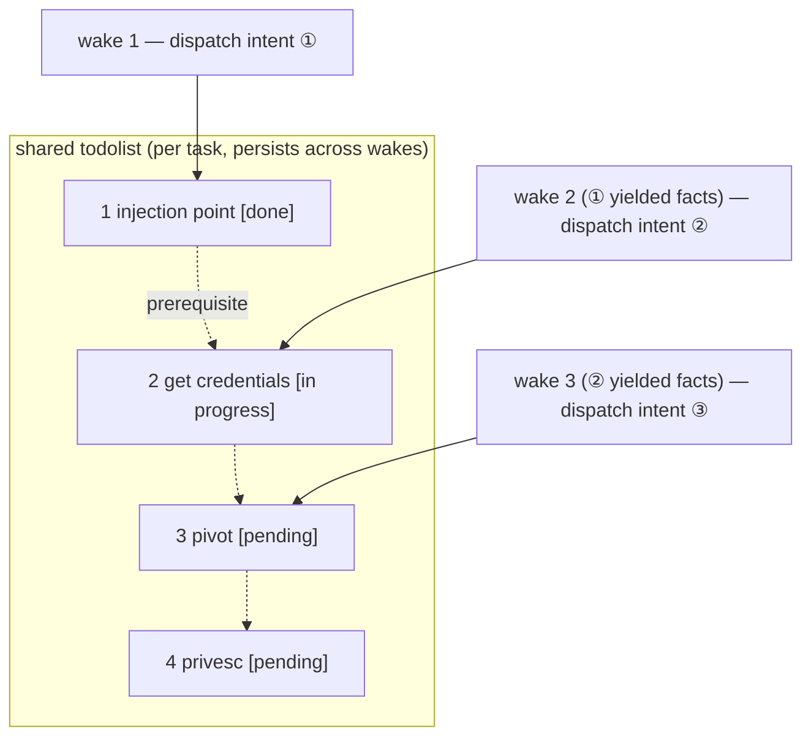

<div align="center">

# ARTEX

AI-autonomous penetration testing system (Go backend + Next.js frontend)

</div>

---

## Screenshots

| Dashboard (overview / token usage / activity stream) | Task list |
|:---: |:---: |
|  |  |

| Task detail · editable from the agent management page | Exploration graph |
|:---: |:---: |
|  |  |

| Findings | Assets |
|:---: |:---: |
|  |  |

| Asset coverage graph (force-directed layout) · highlighted once tested · collapsible nodes |
|:---: |
|  |

| Traffic recording | Chat session |
|:---: |:---: |
|  |  |

| Agent management | LLM configuration |
|:---: |:---: |
|  |  |

| Intercept approval | Backend logs |
|:---: |:---: |
|  |  |

---

## Approval record details

The global "Approval records" page, per-task "intercept approvals", and approval cards inside conversations all expand to show the full detail. The component is adapted from [AegisHook's approval detail component](https://github.com/RuoJi6/AegisHook/blob/main/web/src/components/CallDetail.vue), reusing ARTEX components and theme.

## Asset synchronization (ScopeSentry)

You can sync asset data directly from [ScopeSentry](https://github.com/Autumn-27/ScopeSentry) to avoid collecting it twice:

- Under **Asset sync**, enter the ScopeSentry address and API key to connect the data source.
- Choose which targets and asset types to sync by **project** or **service** (domain / subdomain / IP / port / site / endpoint...).
- One click imports and merges everything into ARTEX's asset graph for agent exploration.

---

## Installation

> Requires **PostgreSQL**; agent runs need an **LLM** (`ANTHROPIC_API_KEY` or `OPENAI_API_KEY`, or configure one in the UI).

### Option 1: One-click install script (recommended)

```bash
git clone https://github.com/Zeerg/artex.git
cd ARTEX
./install.sh
```

The script detects/installs Docker, then lets you pick **(1) all-Docker** or **(2) local build and run**:

- **(1) All-Docker**: enter a Postgres password (press Enter for a random one) → writes `.env` → `docker compose up -d`.
- **(2) Local**: pick the database (use an existing one or start one with Docker) → writes `config.json` → compiles a single embedded binary with `go` → starts it.

After installation open **http://localhost:8787** (first visit goes to `/setup` to set the admin password).

### Option 2: Docker Compose (manual)

```bash
git clone https://github.com/Zeerg/artex.git
cd ARTEX
cp .env.example .env   # set POSTGRES_PASSWORD, optional ANTHROPIC_API_KEY
docker compose up -d   # pulls the zeerg/artex image + postgres
# → http://localhost:8787
```

The image already bundles common tools (ripgrep/curl/vim/npm/nmap...); `./skills` and `./data` are persisted via bind mounts.

Remote MCP can use `http` (Streamable HTTP) or `sse` (legacy SSE) in system settings.
The legacy SSE service normally opens an event stream with `GET /sse`, then receives JSON-RPC
requests on the `/message?sessionId=...` endpoint it returns; when configuring it, set the URL to
`/sse` and pass the request header `Authorization=Bearer <token>`.

### Option 3: Prebuilt binary (Releases)

Download the zip for your platform from [Releases](https://github.com/Zeerg/artex/releases); it contains `artex` + `start.sh` (Windows: `start.bat`) + `skills/` + `config.example.json`:

```bash
cp config.example.json config.json   # fill in the database settings
./start.sh                           # → http://localhost:8787
```

> Always start via `start.sh` / `start.bat`, not `./artex` directly. It is a supervisor script: it decides whether to restart based on the exit code, and the in-page [one-click update](#option-1-one-click-update-in-the-ui-recommended) depends on it. If you run `./artex` directly, it will not come back up after an update.
> Run in the background: `nohup ./start.sh > artex.log 2>&1 &`.

### Option 4: Single binary from source

```bash
# 1) Frontend static export
cd web && npm ci && npm run build:static && cd ..
# 2) Copy it into the embedded directory
cp -r web/out server/webui/dist
# 3) Build (the frontend is only embedded with -tags embedui)
CGO_ENABLED=0 go build -tags embedui -o artex ./cmd/artex
./start.sh
```

### Option 5: Cross-platform release zips

`build.sh` builds and embeds the frontend first, strips debug info via the Go linker, and packs the result into zips. In release mode it produces zips for Linux amd64/arm64, macOS amd64/arm64, and Windows amd64:

```bash
./build.sh --release
# output: dist/artex-0.3.3-*.zip
```

UPX-packed binaries may be incompatible with some Linux kernels, virtualization environments, or security policies, so UPX is off by default. Use `ARTEX_TARGETS` to choose targets; pass `--upx` explicitly when you have confirmed compatibility:

```bash
ARTEX_TARGETS=linux/amd64,windows/amd64 ./build.sh --release
./build.sh --target linux/amd64 --upx
```

---

## Upgrading

> Upgrades only swap the program, not your data: the Postgres volume `pgdata`, `./data` (jwt.key / SQLite etc.) and `./skills` are preserved. **No manual database migration is needed** — `artex` re-runs `schema.sql` idempotently on every start (`ADD COLUMN` / `CREATE INDEX IF NOT EXISTS`), so restarting is the migration. Still, back up `./data` and the database before upgrading.

### Update source for this fork

The one-click updater checks [Zeerg/artex Releases](https://github.com/Zeerg/artex/releases) for new versions. Cloning or updating the source with git also uses `Zeerg/artex`, which is now the Go module path as well.

If you keep the repository private, export `ARTEX_UPDATE_GITHUB_TOKEN` for the backend process; the token needs **Contents: read** on this repo. It is used to query releases and download assets; it is never sent to the browser or committed to git.

```bash
# export ARTEX_UPDATE_GITHUB_TOKEN in the shell or service environment first
./start.sh
```

For local runs, `start.sh` does not read `.env` automatically; the variable must be exported into the process environment. For Docker Compose, put it in the untracked `.env` file and recreate the artex container.

An installable update requires a published (non-draft, non-prerelease) release containing `artex-<version>-<os>-<arch>.zip` plus `SHA256SUMS`. Source-only repositories cannot be updated online.

### Option 1: One-click update in the UI (recommended)

On the **System settings** page (sidebar → `/system/settings`), in the **Version & updates** card, you can check for and install new versions without logging into the server.

Clicking "Update" downloads the release for the current platform → verifies it against the release's `SHA256SUMS` → smoke-tests the new binary with `-h` → saves it as `artex.new` → the process exits and `start.sh` / `start.bat` restarts it on the new version. The page refreshes once the new version is up.

- **No bad state on failure**: if verification or the smoke test fails, the staged binary is discarded and the current version keeps running. If the new version crashes 3 times in a row after install, it rolls back to `artex.old` automatically (the failed binary is kept as `artex.failed` for debugging).
- **Always revertible**: the previous version is kept as `artex.old`, and the card has a "Roll back to previous version" action. Note the database schema does not roll back.
- **Updating interrupts running tasks** — the update restarts the backend, so run it while idle.
- **No updates on dev builds**: when the version is `dev` or has a `git describe` suffix, updating is disabled so a release can't overwrite your debug binary.
- **Docker updates the program, not the image**: bundled tools (playwright/nmap, etc.) are not upgraded, and `docker compose up -d` will revert to the version baked into the image. To upgrade the image use `docker compose pull artex && docker compose up -d artex`.
- If you need a proxy to reach GitHub, set **Global proxy** on the same settings page.

### Option 2: Update script

```bash
cd ARTEX
./update.sh
```

The script optionally does `git pull`, then lets you choose **(1) Docker update** or **(2) local rebuild** (matching `install.sh`):

- **(1) Docker**: optionally pick an image tag (Enter reuses `ARTEX_TAG` from `.env`, default `latest`) → `docker compose pull` → `docker compose up -d` (the new image restarts and migrates automatically).
- **(2) Local**: rebuild the frontend static assets → rebuild `./artex` (takes effect on restart).

### Option 3: Docker Compose (manual)

```bash
cd ARTEX
git pull                          # update compose/scripts (optional)
# pin a version via ARTEX_TAG=v0.2.0 in .env; unset = latest
docker compose pull artex
docker compose up -d artex        # swap image and restart → auto-migrates schema
docker image prune -f             # clean old images (optional)
```

### Option 4: Prebuilt binary (Releases)

Download the new zip from [Releases](https://github.com/Zeerg/artex/releases), stop the old process, replace `artex` and `skills/` (keep your `config.json` and `data/`), then restart:

```bash
cp -r <unzipped>/skills ./ && cp <unzipped>/artex ./
./start.sh
```

### Option 5: Build from source

```bash
git pull
cd web && npm ci && npm run build:static && cd ..
cp -r web/out server/webui/dist
CGO_ENABLED=0 go build -tags embedui -o artex ./cmd/artex
# restart via ./start.sh
```

---

## Configuration

**Database** (`config.json`, or override with `ARTEX_PG_DSN`):

```json
{
  "database": {
    "host": "127.0.0.1", "port": 5432,
    "user": "artex", "password": "yourpass",
    "dbname": "artex", "sslmode": "disable"
  }
}
```

**LLM**: `export ANTHROPIC_API_KEY=sk-...` (or `OPENAI_API_KEY`), or fill it in on the "LLM configuration" page in the UI.
Optional: `ARTEX_LLM_PROVIDER` / `ARTEX_LLM_MODEL` / `ARTEX_LLM_BASE_URL` / `ARTEX_LLM_PROXY`.

**Concurrency**: the number of worker agents per task is configured under "System settings" (default 3).

**Common flags**: `./start.sh -addr :8787 -proxy :8788` (`-addr` is the frontend+API port, `-proxy` the traffic recording proxy). The start script passes flags through to `artex`.

### Reverse proxy deployment (HTTPS / only 443 open)

The frontend and the API/SSE share one backend port (default `:8787`), and the realtime activity stream defaults to the **same origin**, so **you do not need `NEXT_PUBLIC_SSE_BASE`** — expose only 443 publicly and keep 8787 internal.

SSE is a long-lived connection with continuous pushes; the reverse proxy **must disable buffering**, otherwise the browser connects but never receives events (the activity stream just spins). Nginx example:

```nginx
server {
    listen 443 ssl;
    server_name your.domain.com;
    # ssl_certificate / ssl_certificate_key ...

    location / {
        proxy_pass http://127.0.0.1:8787;
        proxy_set_header Host $host;
        proxy_set_header X-Forwarded-Proto $scheme;

        # SSE essentials: no buffering, long timeout, HTTP/1.1
        proxy_buffering off;
        proxy_cache off;
        proxy_read_timeout 3600s;
        proxy_http_version 1.1;
        proxy_set_header Connection "";
    }
}
```

> Only if SSE must be served from a different origin than the page (e.g. a separate subdomain) do you need to set `NEXT_PUBLIC_SSE_BASE` at **build time** (it is baked into the static bundle by `next build`; setting it at container runtime has no effect).

---

## Development

### Manual finding retesting

The task detail "Retest" tab lets you multi-select findings across pages, review previous conclusions and evidence, and start a manual retest. While it runs, the tab shows a spinner and "Retesting"; when the fix is confirmed, the finding status is updated automatically.

Click "Retest" in each row's action menu in the findings list, or "Start retest" in the finding detail's "Finding retest" section. You can optionally enter the fixed version, test conditions, or restrictions. The system creates an independent retest agent session and keeps you on the page. The flat view, task-grouped view, and asset view all expose the same entry point. Conclusions are "Still reproducible", "Fixed", or "Cannot confirm"; each retest's conclusion, evidence, and session link is saved on the finding.

Fresh installs come with an editable `retester` agent for retesting; configure its prompt, LLM, run budget, and tools under Agent management. It uses its bound LLM, or the global active configuration if unbound. When a retest finishes with conclusion "fixed", the finding's status is changed to "fixed" automatically; in-progress, failed, stopped, or other conclusions leave the status unchanged. Original evidence and reports are always kept. You can also set "fixed" manually from the status dropdown. While a retest for the same finding is already running, the existing session is reused; it can be restarted after a stop, failure, or backend restart.

Retest history is visible from the finding detail and sessions. It is not included in finding report exports or task archive packages, and is not auto-linked to traffic records. In demo mode only clearly-marked simulated records are produced; no requests are sent to real targets.

### Local development

```bash
./dev.sh   # backend (:8787) + traffic proxy (:8788) + frontend next dev (:5173) → http://localhost:5173
```

- Backend: `go run ./cmd/artex` (omit `-tags embedui` to skip embedding the frontend)
- Frontend: `cd web && npm run dev` (proxies `/api` to the backend, hot reload)
- Tests: `go test ./...`
- Mock preview (no backend): `cd web && NEXT_PUBLIC_MOCK=1 npm run dev`

---

## Architecture

ARTEX is an **LLM-driven, multi-agent autonomous pentest system**: a single Go backend (with the Next.js frontend embedded) + PostgreSQL. Agent capabilities come from the [`norma`](https://github.com/Autumn-27/norma) SDK (`agentcore` / `tool` / `permission` / `harness` / `memory` / `transcript`). The core is a **dual-graph architecture**, plus two autonomy mechanisms built around it: **mid-run information exchange between workers** and a **planner-owned multi-round shared todolist** for stable attack chains.

### High-level layering



| Layer | Responsibility |
| --- | --- |
| **Frontend** | Next.js static export, embedded into one binary via `go:embed`; visualizes tasks/assets/exploration graph/coverage, human-in-the-loop chat |
| **server** | `net/http` routing + JWT auth + SSE; `Manager` owns the lifecycle of tasks, engines, and the DB store |
| **engine** | Per task: `plannerLoop` + N worker goroutines; intent claiming, timeouts, pause/drain |
| **agent** | goals / planner / worker / mainagent; `ToolSet` exposes the dual graph to the LLM |
| **db** | Dual-graph persistence in PostgreSQL (pgx); `go:embed` schema applied idempotently on each start |
| **support** | Recording MITM proxy, approval gate, async enrichment, MCP/skills/memory/report |

### Dual graph: exploration graph + asset graph

The system splits **"what is the target"** from **"how far have we tested"** into two independent graphs joined by anchors:

- **Asset graph (globally shared)**: the shared source of truth for assets across tasks. Nodes are `root_domain / subdomain / ip / service / app / endpoint`, attached to companies; domain→subdomain→service→endpoint relationships and dedup keys are computed by the program — agents only submit raw observations.
- **Exploration graph (per task)**: the "thinking and progress" of a single task. Nodes are `goal / intent / fact / finding / hint`, linked by `spawns / derived_from / yields / proves` edges into a **lineage chain** answering "which direction came from which facts, and what it produced".
- **Linked by anchors**: `exploration_anchors(node_id, asset_id)` ties intents/facts/findings to concrete assets — so you can see which assets an exploration direction is attacking, and look back from a given asset to every intent that tested it and the facts it derived. This powers **asset test coverage** and the **coverage graph** (in-scope assets highlighted once tested).



> Division of labor: **planner** reads the exploration graph, evaluates coverage, and dispatches an **intent** to the frontier only when a new uncovered direction exists; each **worker** owns **one intent**, runs real tools, and writes new assets/facts/findings back to both graphs. The asset graph is shared ground truth; the exploration graph is each task's progress chain.

### Engine and intent lifecycle (one exploration loop)

The engine is an **event-driven** loop: a graph change wakes the planner, the planner dispatches intents, workers claim and execute them and write results back, which triggers the next round — until the goal is proven (`prove_goal`).



### Mid-run information exchange between workers

During deep exploration, many valuable observations (an error, a response fragment, a hidden parameter) appear mid-run in one worker's transcript but are never written up as formal facts. To avoid duplicated work and let workers build on each other, workers can **search each other's transcripts**:

- `search_all_worker_traces(q)`: keyword search over **other workers' transcripts for this task** (automatically excludes the current intent's steps); matches carry `intent_id`;
- `list_worker_traces` / `get_worker_trace(intent_id, step_ids=[...])`: first see which intents ran, then pull the detailed steps for a specific intent.

So even before an observation lands on the exploration graph, later workers can reuse what earlier ones saw — **fine-grained knowledge flows between workers through transcripts**, while the boundary stays intact (each worker still only does what it was assigned).



### Planner's multi-round shared todolist → stable attack chains

Real attack chains are **multi-step sequences with dependencies** (find an injection point → get credentials → pivot → privesc): the planner keeps a **per-task todolist that persists across wakes**:

- The planner is event-driven — it wakes on graph changes but **starts a fresh session each wake**; the shared todolist lets it **record a serial exploitation chain once**, then **dispatch intents step by step as dependencies are satisfied**, instead of expanding the whole chain in one round;
- Each round only dispatches intents whose prerequisites are complete and whose dependency facts already exist, marking steps off as facts satisfy them.



This is how an "event-driven + stateless session" architecture still makes **steady, ordered, non-repeating progress** — the key to ARTEX completing multi-step exploitation chains autonomously.

---

## Acknowledgements

https://github.com/oritera/Cairn


## License and disclaimer

### Open source license

This project is licensed under **GNU Affero General Public License v3.0 (AGPL-3.0)**; see the [LICENSE](LICENSE) file at the repository root.

This means anyone may freely use, modify, and distribute the project, but **derivative works must also be open-sourced under AGPL-3.0**; in particular, **if you modify this project and offer it to users over a network (e.g. as a hosted service), you must publish the complete corresponding source code**.

> ⚠️ **Important notice**: the open source license itself does not restrict how the software is used. The "permitted use" and "prohibited use" terms below are additional conditions and a solemn declaration by the author — please honor them.

**ARTEX is intended for personal learning, code study, and local technical validation only. Do not use it to run actual tests against any online system or website.**

### Permitted use

- Reading, learning, and studying this project's source code, and verifying technical principles in an **isolated local environment**;
- Personal study, academic research, code review, and other non-malicious purposes.

### Prohibited use

- **Any scanning, probing, exploitation, or attack against any website, online service, or networked system** (regardless of authorization or ownership);
- Any real-world penetration testing, defensive operations, or use in a production environment;
- Illegal intrusion, data theft, extortion, denial of service, or any destructive or criminal activity;
- Any activity that violates the laws and regulations of your jurisdiction.

### Compliance responsibility

Users must comply with all applicable cybersecurity, data protection, and computer-crime laws and regulations in their jurisdiction. **All legal responsibility and consequences arising from the use of this tool rest solely with the user.**

### Disclaimer

This project is provided **"AS IS"**, without warranty of any kind, express or implied. The author and contributors are not liable for any direct or indirect loss, data loss, system damage, or legal dispute arising from the use of this tool, whether used appropriately or not. **Downloading, installing, or using this project means you have read, understood, and agreed to all of the above terms.**
