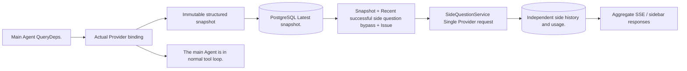

# ARTEX `/btw`

Ordinary chat, task MainAgent, and the current task's own Worker support independent side questions. Input into the main input box `/btw Issue` Can be submitted, empty `/btw` Or“Lateral Questioning,”Button opens history. Desktop uses a resizable sidebar, mobile uses Drawer.

The sideline answer is generated based on the snapshot of the Agent's context at submission time and supports streaming display, follow-up questions, stopping, and clearing. Closing the panel, refreshing the page, or disconnecting SSE does not cancel the model request. Stopping only affects the current sideline; clearing cancels the sideline and deletes its history while retaining the main context snapshot.

## Implementation Boundary,

Using Go, norma v0.3.7, Next.js, Existing Markdown / ResizablePanel / Drawer / AlertDialog components; no modification of norma source code or addition of dependencies for side channels. Planner, Worker inherited from other tasks, tool-type sub-tasks upgrades not within this scope.

- `capture.go` Only In `Options.Deps.CallModel / CallModelSync` Mark main loop request. Provider decorator is inside specific model, after outer layer selection of route pool, so records the actual selected model; compression and summary requests do not overwrite snapshots.
- Request start, full model response, final state snapshot published quickly. Half-baked responses are not published; tool calls through norma's `MessagesForAPI` Kept paired. Tool results are saved in the next main model request or when the final state enters a snapshot. Streaming termination retains the last valid boundary.
- Snapshot retained through JSON deep copy, preserving structured messages, system prompts, tool definitions, and generation parameters. Model inference does not hold snapshot locks or database transactions.
- `SideQuestionService` Call the specific Provider; if necessary, first generate a side-channel summary. The final answer is only allowed to be shortened and retried once when the initial context exceeds its limit and no text/tool call has been output yet. No agent session is created, no tool executor, main transcript, activity stream, or task graph is accessed, nor does it go through the task model switch chain. Retaining tool definitions is for compatibility with existing structured tool contexts; summary requests do not provide tools. The new returned tool calls have no execution path.
- Each parent session has one run request, with a single service process having up to four. Single timeout 120 seconds. Side-channel uses an independent cancellation context under the service lifecycle.
- Intercepted requests retain model configuration references and non-sensitive identity summaries; credentials are obtained from existing configurations. If the configuration is deleted or if identity fields such as models, protocols, addresses change, run the main Agent to update snapshots first. Testing does not alter the default model of the product.

## Persistence and recovery

`db/schema.sql` Auto Create, `side_question_sessions` And `side_question_requests`. The former saves parent resource, latest snapshot, run number, version and cleanup version; the latter saves issue, cumulative answers, status, model, snapshot time, usage, event sequence number and pagination sequence number.

Parent session key uses conversation ID or task ID. + exploration ID + intent ID. Worker Not using reusable execution slot naming.

Snapshots are merged and written by parent session, refreshed every 250 ms, database comparison `(run_id, version)` Prevent old versions from overwriting. Before side submission, save the selected snapshot again. After successful saving, release the large snapshot in memory; if it fails, retain the pending write version. Write accumulated content to the stream event at most once every 250 ms when it arrives, and immediately save the final state with limited retries on database errors.

Service startup will leave `running` Request marked as `interrupted`, Retain parts of the stored answers and usage, do not automatically replay requests. The most recently saved context can be directly used for the next question. For old sessions without snapshots, run the main Agent first; do not rebuild the context from UI activity records.

Clear operation incremental cleanup version and delete requests; conditionally update to prevent late callbacks from rewriting. Physical parent resource deletion relies on foreign key cascading. Worker logical deletion deletes side data in the same transaction and rejects subsequent late snapshots. Task archiving first prevents new requests, waits for the main process to stop, cancels it, and waits for side data to be stored; the archive format is v3, while also compatible with v1/v2 without side tables.

Historically save completely, return up to 20 items per page based on sequence number cursor. The model can replay up to the last 20 successful question-answer pairs in their original form while limiting playback by token budget; older questions maintain independent rolling summaries. When the main context exceeds the budget, only summarize the old part of the bypass copy, retaining recent structured tool calls and results. Include summary, preparation progress, and usage in the concurrent, cancelable, and 120-second timeout limits for the bypass. See details at [context budget with open-source reference](CONTEXT_BUDGET.md).

## HTTP Contract

The following paths are used as `{parent}`, Reuse existing authentication and resource validation:

- `/api/conversations/{id}`
- `/api/tasks/{id}/chat`
- `/api/tasks/{id}/intents/{iid}`

| Request | Return and behavior |
| --- | --- |
| `GET {parent}/side-questions?before={ordinal}` | `items` Sort by new to old, independently `current` Running status,`snapshot` Metadata,`next_cursor`; Cursor 0 indicates latest page / no next page |
| `POST {parent}/side-questions` | JSON `{ "question": "...", "client_request_id": "UUID" }`; New request returns 202 and request object; same ID and issue return existing object 200 |
| `DELETE {parent}/side-questions` | Cancel and clear the current parent session's side questions. |
| `GET /api/side-questions/{requestID}/events` | `snapshot` SSE Event,`id` For incrementing sequence numbers,`data` To accumulate complete request objects; send when cleared `cleared` |
| `POST /api/side-questions/{requestID}/cancel` | Explicit cancellation; the final state can be read from history or SSE. |

Question limit 4000 characters. No snapshot, model configuration changes, same parent session busy or idempotent ID conflict returns 409; global concurrent limit returns 429. Each SSE connection first sends the cumulative status, not dependent on the client's previously received text fragments. Frontend by request ID + Merge serial numbers, and discard old callbacks when switching parent sessions or clearing.

## Verification and reference

Automated checks, actual model usage, and known limitations are in [VALIDATION.md](VALIDATION.md).

Independent request reference [Grok CLI side-question.ts (Fixed submission)](https://github.com/superagent-ai/grok-cli/blob/fb97af83f06dca873281d60168430f06c8de6324/src/utils/side-question.ts), Run isolation reference [OpenCode (Fixed submission)](https://github.com/anomalyco/opencode/tree/b3f1a96c6dd7adeb28b36dd11add1998fc84d67b). ARTEX Context uses norma's structured message, not textsplicing from frontend logs.
