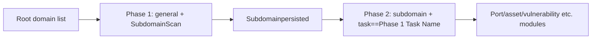

---

name: scopesentry-mcp
description: Manage the security scanning platform (projects, tasks, templates, assets, nodes) through ScopeSentry MCP. Use when users mention ScopeSentry, MCP, API Key, scan tasks, asset queries.

# ScopeSentry MCP User Guide,

Oriented towards**A ScopeSentry instance has been deployed.**Users. Connect to the platform through Cursor (or other MCP client), without needing local source code.

## 1. Preparation Work,

### 1.1 Confirm service accessibility

- Default Web interface:`http://<Host>`
- MCP Endpoint:`http://<Host>/mcp` (If there is a reverse proxy or frontend proxy, get the actual `/mcp` Address is authoritative)

### 1.2 Create API Key

1. Browse the ScopeSentry Web interface with browser login.
2. Wake Up **API Key** Create a key on the management page (or through an interface provided by the administrator).
3. Save returned `ssk_...` String (**Show only once**)

### 1.3 configure Cursor MCP

Cursor → Settings → MCP → Add server:

```json
{
 "mcpServers": {
 "scopesentry": {
 "url": "http://<Your host>:8082/mcp",
 "headers": {
 "X-API-Key": "ssk_Your Key,"
 }
 }
 }
}
```

Also usable:`Authorization: Bearer ssk_Your Key,`

Restart MCP or reload Cursor after configuration to confirm tool list appears. `list_projects`, `list_assets` End.

---

## 2. Tool Overview,


| Chat | Usage |
| ---------------------- | ----------------- |
| `list_projects` | Project tree grouped by labels (including project ID). |
| `list_projects_data` | Paginate project list, searchable by name. |
| `get_project` | Project Details |
| `create_project` | New project. |
| `list_tasks` | Scan Task List |
| `get_task` | Task details. |
| `list_scan_templates` | Scan template list |
| `get_scan_template` | Template details |
| `list_plugin_modules` | Scan pipeline module name |
| `list_plugins` | Available plugins (including hash, default parameters) |
| `create_scan_template` | Create scan template |
| `create_scan_task` | Create scan task |
| `list_assets` | Query various assets (paginated list). |
| `count_assets` | Count assets (`/api/assets/common/total`) |
| `get_asset_detail` | Asset or vulnerability details. |
| `add_asset_tag` | Add tags to assets |
| `list_nodes` | Scan Node List |


Tool parameters based on MCP tool description (schema).`list_assets` / `count_assets` The search and filter syntax is consistent, read before querying assets `list_assets` description.

Use when you need to know 'how many' `count_assets` (No need to repeatedly flip through pages for total count via corresponding Web pagination API. `list_assets`.

---

## 3. Common workflows

### 3.1 Search assets by project

When user or context**Existing project conditions.**When, prioritize including `filter.project` Narrow down the scope to avoid excessive cross-project data causing response slowdown. If no specific project is clear, project filtering can be optional.

1. `list_projects` Or `list_projects_data` Get target project's **ObjectID** (`id` / `children[].value`)
2. `list_assets` When Used `filter.project` (**Must be an ID, cannot write project Chinese names.**)

```json
{
 "asset_type": "asset",
 "pageIndex": 1,
 "pageSize": 20,
 "search": "domain=^example.com",
 "filter": {
 "project": ["<Project ObjectID>"]
 }
}
```

### 3.2 Create scan task

1. `list_nodes` Get online node name
2. `list_scan_templates` Or `create_scan_template` Get Template **ObjectID**
3. `create_scan_task`: `name`, `node` Required,`template` Fill template ID (cannot fill template name)

**Target Source, `targetSource` (Consistent with web end):**

| targetSource | Description | Required parameters. |
| --- | --- | --- |
| `general` | Directly input target | `target` |
| `project` | Reading target from project. | `project` (Project ObjectID array) |
| `asset` | Search from Web asset library | `search`; Optional `project`, `filter`, `targetNumber` |
| `RootDomain` | Search for root domain library | `search`; Optional `project`, `filter`, `targetNumber` |
| `subdomain` | Search from subdomain library. | `search`; Optional `project`, `filter`, `targetNumber` |
| `UrlScan` | Searching for scan results from the URL. | `search`; Optional `project`, `filter`, `targetNumber` |
| `*Source` (Like `subdomainSource`) | From asset page 'select/search' create, | `targetTp=search` Can Be Sorted By `search`; `targetTp=select` Can Be Sorted By `targetIds` |

**Example — Directly scan root domain:**

```json
{
 "name": "example-Subdomain collection",
 "node": ["node-1"],
 "template": "<template ObjectID>",
 "targetSource": "general",
 "target": "example.com\nfoo.com",
 "project": ["<Project ObjectID>"]
}
```

**Example — Continue scanning from the subdomain library (filter by previous task name):**

```json
{
 "name": "example-Port and vulnerability",
 "node": ["node-1"],
 "template": "<Subsequent module template ObjectID>",
 "targetSource": "subdomain",
 "search": "task==\"example-Subdomain collection\"",
 "project": ["<Project ObjectID>"]
}
```

### 3.3 Full root domain information collection (recommended in two stages)

When input is**Root domain**And must perform**Full Information Collection**When doing so, it is recommended to scan in two parts, not running the entire pipeline at once.

**Reason:** Distributed tasks with**Single Target**Distributed by unit. When the root domain is the target, if a node receives this root domain, any subdomains discovered on that node will continue to execute subsequent modules on that node, leading to uneven load distribution, slow speed, and easy errors.

**Best practices:**

1. **First phase. — Only subdomain collection**
 - `targetSource`: `general`
 - `target`: All root domains (multi-line)
 - Template: Only enable `SubdomainScan`, `SubdomainSecurity` (Subdomain scan + Subdomain takeover)
 - Use `get_task` Wait for task completion

2. **Second stage. — Subsequent modules**
 - `targetSource`: `subdomain`
 - `search`: `task=="<First phase task name>"` (Exact match task name)
 - Optional `project` Narrow Scope,
 - Template: port scanning, asset mapping, vulnerability scanning, etc. (SubdomainScan may be excluded)
 - Subdomains distributed as independent targets to nodes for higher parallel efficiency.

You can also use 'Create Task from Subdomain' on the Web interface's 'Subdomains' asset page after filtering by task name to achieve the same effect.



### 3.4 Create scan template

1. `list_plugin_modules` → Module name list
2. `list_plugins` (Return `module` Filter)→ Each plugin `hash` With default `parameter`
3. `create_scan_template`: Use `modules` Specify'Module → Plugin hash array'

---

## 4. Asset query (`list_assets` / `count_assets`)

`count_assets` And `list_assets` Use the same `asset_type`, `search`, `filter`, Support `{ "total": N }`, Corresponding web end `/api/assets/common/total`.

```json
{
 "asset_type": "subdomain",
 "search": "task==\"Certain Task Name,\"",
 "filter": {"project": ["<Project ObjectID>"]}
}
```

**Performance suggestions (`list_assets` / `count_assets` General):** Prefer project conditions when available `filter.project` Narrow down scope; `search` Use existing indexed fields as much as possible in the project `==` Fully equal or `^` Prefix matching (see [4.3](#43-search-Search expression)), Avoid large-scale `=` Fuzzy query slows down response. Do not force project filtering when there is no project context.

Reduce `filter.project` Type see. [4.4](#44-filter-Precise Filtering,) Table.

### 4.1 Asset Type, `asset_type`

`asset`, `RootDomain`, `subdomain`, `app`, `mp`, `UrlScan`, `SensitiveResult`, `DirScanResult`, `crawler`, `vulnerability`, `PageMonitoring`, `IPAsset`, `SubdomainTakerResult`

Alias example: `web`→asset, `vuln`→vulnerability, `ip`→IPAsset, `url`→UrlScan

### 4.2 Parameter Description,


| Parameter | Description |
| ------------------------ | --------------------------------------- |
| `pageIndex` / `pageSize` | Pagination, default 1 / 20 |
| `search` | search expression (see next section) |
| `filter` | Precise JSON filtering (see next section) |
| `sort` | Only UrlScan and DirScanResult support sorting by `length` Sort |
| `sid` | Only for SensitiveResult: sensitive rule name |


`search` And `filter` **Can be used simultaneously.**.

### 4.3 search Search expression

Custom DSL (**Not SQL**):


| Operator | Meaning | Index | Example |
| ---- | ---- | ---- | --------------------------- |
| `=` | Fuzzy matching (regex) | Do not use index. | `domain=example` |
| `==` | Exact match (full equality) | **Use index** | `port==443` |
| `!=` | Exclude | — | `port!="80"` |
| `&&` | And | — | `domain==example.com && port==443` |
| `||` | Or | — | `title=admin || body=login` |


**Index with operators:** `domain`, `ip`, `port`, `title` Fields indexed but only **`==` Equal** Or **Value should be `^` Prefix match at the beginning** (Like `domain=^example.com`)Can use index;**`=` Will be converted to regex fuzzy matching, unable to use indexes.**, Can slow down when data volume is large.

**Common search fields for all types:** `tag`, `task` (Task name),`rootDomain`

**project Cannot be written in search** (Invalid or unrelated `&&` Error during combination. Filter projects using `filter.project`.

**Common search fields for each type:**


| asset_type | Field |
| -------------------- | ----------------------------------------------------------------------------------- |
| asset | domain, ip, port, service, app, title, statuscode, icon, banner, type, body, header |
| RootDomain | domain, icp, company |
| subdomain | domain, ip, type, value |
| app | name, icp, company, category, description, url, apk |
| mp | name, icp, company, category, description, url |
| UrlScan | url, input, source, resultId, type |
| SensitiveResult | url, sname, body, info, md5 |
| DirScanResult | url, statuscode, redirect, length |
| vulnerability | url, vulname, matched, request, response, level |
| crawler | url, method, body, resultId |
| PageMonitoring | url, hash, diff, response |
| IPAsset | ip, domain, port, service, webServer, app |
| SubdomainTakerResult | domain, value, type, response |


**search Example:**

- `domain==www.example.com && port==443` (Full equality, use index)
- `domain=^example.com` (Prefix match, use index)
- `ip==192.168.1.1`
- `task=="Certain Task Name,"`
- `level==high` (vulnerability)
- `statuscode==200` (DirScanResult)

Use when fuzzy matching is required. `=`, Like `title=admin` (Do not use index, suitable for narrowing down the scope with project conditions.)

### 4.4 filter Precise Filtering,

JSON Object: Multiple values for the same key. **OR**, Different keys are **AND**.

**Prefer project conditions when available `project`: ** If the user or context explicitly specifies a project, and asset_type supports it `project`, Should include to narrow down the scope; no project information is not mandatory.


| filter key | Meaning | Value Explanation |
| ------------ | -------- | -------------------------------------------------------- |
| `project` | Belongs to project. | **ObjectID**, Use `list_projects` / `list_projects_data` Retrieve |
| `task` | Source Task | **Task name.**, Use `list_tasks` To `name` |
| `port` | Port | Like `"443"` |
| `service` | Service/Protocol | Like `"https"` |
| `app` | Application fingerprint | Like `"Nginx"` |
| `icon` | Icon hash. | |
| `statuscode` | HTTP Status Code | Mainly used for asset |
| `status` | Status | UrlScan/DirScan HTTP Code; vulnerability/sensitive information processing status. |
| `level` | Vulnerability Level | critical / high / medium / low / info |
| `type` | type | Such as subdomain record types A, CNAME |
| `color` | Sensitive rule color | SensitiveResult |
| `sname` | Sensitive rule name | SensitiveResult |
| `tags` | Label | |


**Available filter keys for each type:**


| asset_type | filter key |
| ------------------------------------- | --------------------------------------------------------------- |
| asset | project, port, service, app, icon, statuscode, type, task, tags |
| RootDomain | project, tags |
| subdomain | project, type, task, tags |
| app / mp | project, tags |
| UrlScan | status, tags |
| DirScanResult | status, tags |
| SensitiveResult | status, color, sname, tags |
| crawler | project, task, tags |
| vulnerability | project, level, status, task, tags |
| PageMonitoring / SubdomainTakerResult | tags |
| IPAsset | project, port, service, app |


**filter Example:**

```json
{"project": ["<Project ObjectID>"], "port": ["443"]}
```

**Combined query example:**

```json
{
 "asset_type": "asset",
 "search": "domain=^baidu && port==443",
 "filter": {"project": ["<Project ObjectID>"]},
 "pageIndex": 1,
 "pageSize": 10
}
```

**Note:**

- Prefer to include project conditions when available `filter.project` (Supported when; no project context can be omitted
- `filter.project` Do not fill in the project display name.
- Known Values Used `==`, Prefix used `^`; Avoid overusing large tables `=` Fuzzy Match,
- UrlScan HTTP status code `filter.status`; DirScanResult Can be used in search `statuscode==200`
- SensitiveResult By rule name: `search` Use `sname=Rule name`, Or `filter.sname`

### 4.5 Sort sort

Only **UrlScan**, **DirScanResult** Supports:

```json
{"length": "ascending"}
```

Ignore other types `sort`, Sort by time by default.

---

## 5. Scan template module name

`TargetHandler`, `SubdomainScan`, `SubdomainSecurity`, `PortScanPreparation`, `PortScan`, `PortFingerprint`, `AssetMapping`, `AssetHandle`, `URLScan`, `WebCrawler`, `URLSecurity`, `DirScan`, `VulnerabilityScan`, `PassiveScan`

---

## 6. Fault Diagnosis,


| Phenomenon | Handle |
| --------- | -------------------------------------------------- |
| MCP No tool | Check URL, API Key, ScopeSentry if they are running. |
| 401 / 403 | Re-create or change the API Key. |
| Asset not found. | Confirm `filter.project` As ObjectID; do not write project in search |
| Template/task creation failed. | `template` Must be a template ObjectID;`node` Fill Online Node Name |
| Query slow/stuck. | Add when there is a project; `filter.project`; search Switch to using for indexed fields. `==` Or `^` Prefix, less used `=`; Therefore `pageSize` |


---

